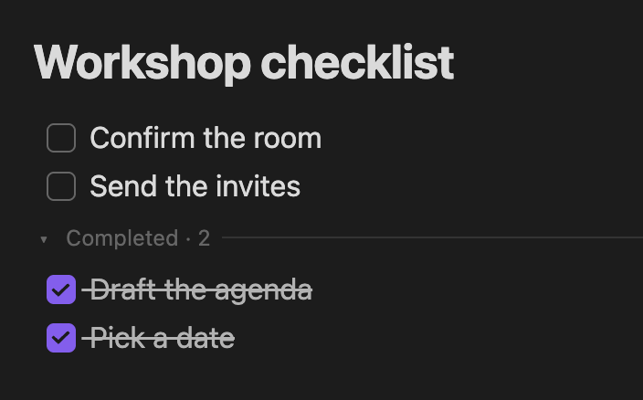
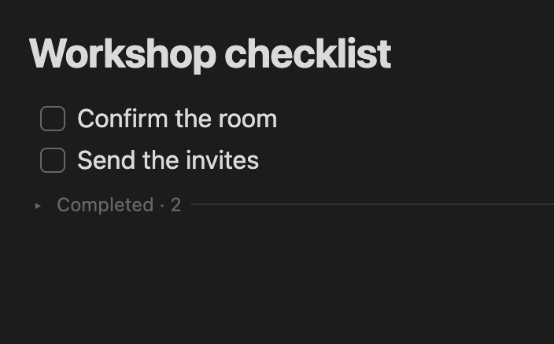

# Obsidian Plugins

A collection of personal Obsidian plugins.

## Checked to Bottom

Keep unfinished tasks at the top of your Markdown checklists. When you check off a task in Live Preview, it moves below the unchecked tasks in the same list. Uncheck it to move it back above the completed tasks.

Nested tasks and attached text move with their parent. Use the **Completed** row to collapse or expand finished tasks without removing them from your note.

Starting with v0.1.1, opening a note for editing groups unchecked tasks above checked tasks within each checklist and saves the new order. Use Undo to restore the previous order.

| After checking **Draft the agenda** | After clicking **Completed · 2** |
| --- | --- |
|  |  |

### Install with an AI assistant

If your AI assistant has access to your local files, copy this prompt into it.

```text
Install Checked to Bottom v0.1.1 in my Obsidian desktop vault. Use this release ZIP:
https://github.com/AhmedShura/obsidian-plugins/releases/download/checked-to-bottom-v0.1.1/checked-to-bottom-0.1.1.zip

If I haven't named a vault and there are several, ask which one to use.
Extract the checked-to-bottom folder into the plugins folder inside that vault's
active configuration folder (.obsidian by default). If a different version is
already installed, tell me its version and ask before replacing it.

Refresh the plugin list, enable Checked to Bottom, and verify it is loaded in
the chosen vault. If Obsidian asks for trust or you can't enable the plugin,
tell me which step to complete in Obsidian.
```

### Install manually on desktop

1. Download [Checked to Bottom v0.1.1](https://github.com/AhmedShura/obsidian-plugins/releases/download/checked-to-bottom-v0.1.1/checked-to-bottom-0.1.1.zip).
2. Unzip it and copy the `checked-to-bottom` folder into your vault’s `.obsidian/plugins/` folder. Create `plugins` if it’s missing. If you use a custom configuration folder, use its `plugins/` folder.
3. Restart Obsidian. In **Settings → Community plugins**, turn on community plugins if needed, then enable **Checked to Bottom**.

### Build from source

From `plugins/checked-to-bottom/`, run `npm ci`, `npm test`, and `npm run build`. Node.js 26 is compatible with the locked development dependencies. The build writes `main.js` next to the manifest and stylesheet.

## License

[MIT](LICENSE)
