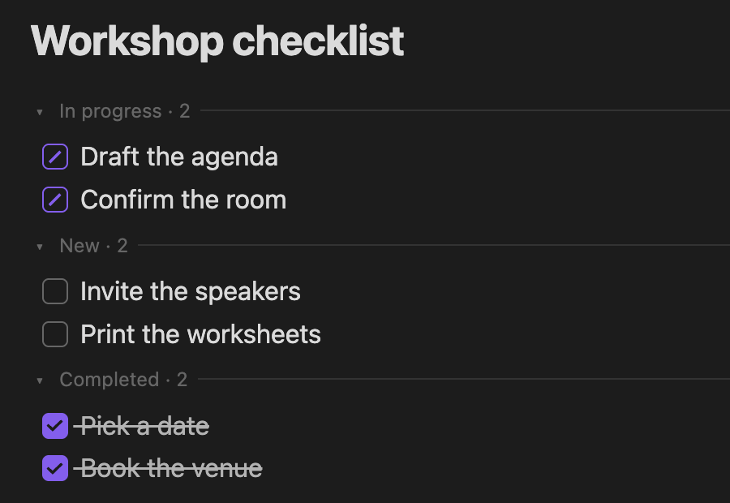
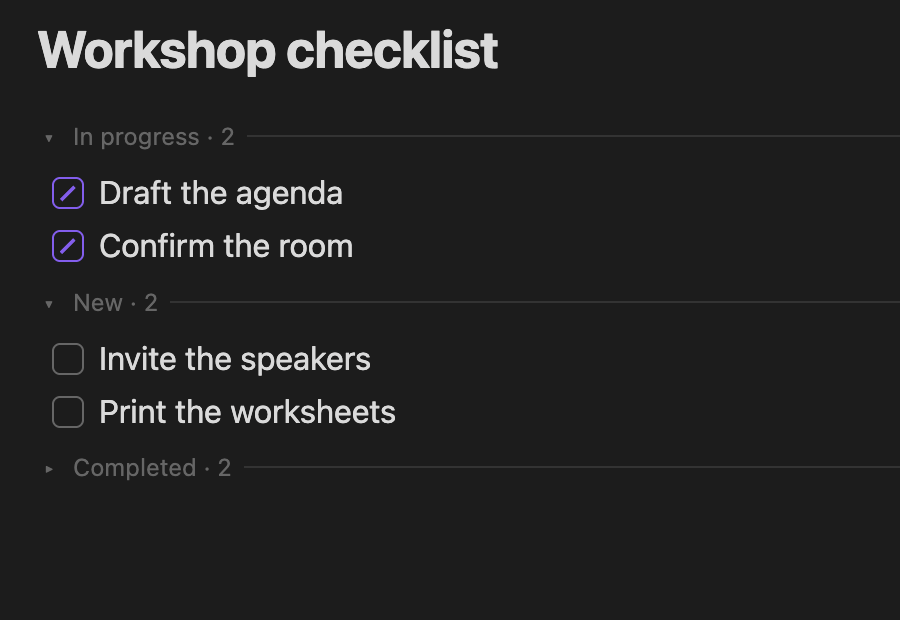

# Obsidian Plugins

A collection of personal Obsidian plugins.

## Checklist Stages

Cycle tasks through **New** `[ ]`, **In progress** `[/]`, and **Completed** `[x]` by clicking their checkboxes in Live Preview. Each click moves the task to the top of its destination section. The checklist shows in-progress tasks first, then new tasks, then completed tasks. Use Undo to restore the task's previous state and position.

Nested tasks and attached text move with their parent. Click any section heading to collapse or expand it. All sections start expanded. In Source mode, you can edit the Markdown marker directly.

Opening a note for editing groups each checklist and saves the new order. Use Undo to restore the previous order.

| All stages expanded | Completed collapsed |
| --- | --- |
|  |  |

### Build from source

From `plugins/checklist-stages/`, run `npm ci`, `npm test`, and `npm run build`. Node.js 26 is compatible with the locked development dependencies. The build writes `main.js` next to the manifest and stylesheet.

### Install on desktop

1. Create a `checklist-stages` folder inside your vault’s `.obsidian/plugins/` folder. If you use a custom configuration folder, use its `plugins/` folder.
2. Copy `main.js`, `manifest.json`, and `styles.css` from the build into `checklist-stages`.
3. Restart Obsidian. In **Settings → Community plugins**, turn on community plugins if needed, then enable **Checklist Stages**.

If you’re replacing [Checked to Bottom v0.1.1](https://github.com/AhmedShura/obsidian-plugins/releases/download/checked-to-bottom-v0.1.1/checked-to-bottom-0.1.1.zip), disable **Checked to Bottom** before enabling **Checklist Stages** so the two plugins don't handle the same checkbox. Verify the new plugin in Live Preview, then uninstall the old one. Your tasks stay in your Markdown notes.

## License

[MIT](LICENSE)
